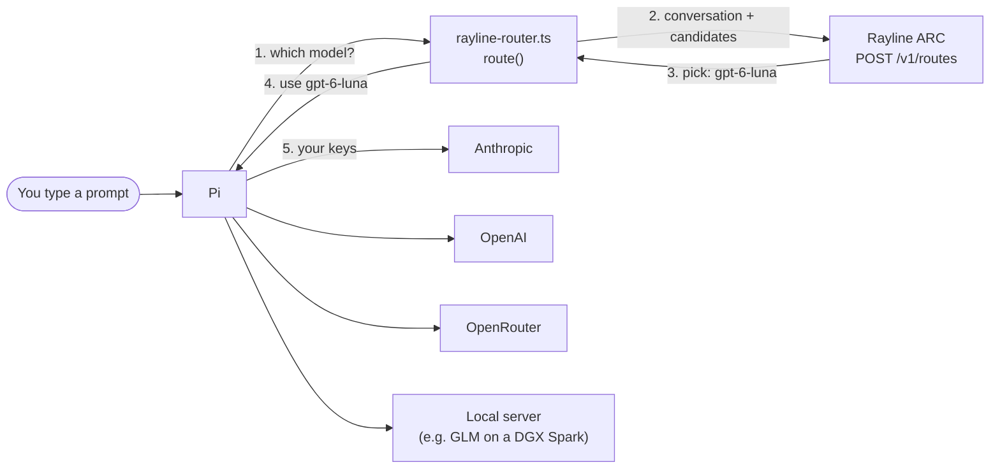

# Rayline routing inside Pi

A [Pi](https://pi.dev) extension that lets Rayline's ARC router pick the model
for each turn. You talk to one model, `rayline/auto`; behind it, ARC chooses
between the models you list (cloud models, and optionally a model you run
locally), and Pi sends the turn to that model with your own provider keys.

This is an example, not a supported product. `raydock hybrid run pi` is the
supported way to run Pi with hybrid local/cloud routing; this extension shows
the same idea built natively into Pi.

## How it works



1. Before each request, Pi asks the extension which model to use. Pi 1.1+
   calls this a *virtual model*: a model whose `route()` picks a real one.
2. On a new user message, the extension sends the conversation and the list
   of candidate models to Rayline (`POST /v1/routes`).
3. ARC answers with one of the candidates (and a thinking setting).
4. Pi runs the turn on that model itself, so the footer, `/session` costs and
   context limits all show the model that really answered.
5. Tool-call follow-ups stay on the same model without asking again, so a
   task doesn't switch models halfway through (and keeps its prompt cache).

If Rayline can't be reached, the turn stays on the last model (or a local
model when the network is down), and Pi shows a warning.

### Two modes

| | Cloud mode (`cloud.json`) | Local mode (`local.json`) |
|---|---|---|
| Candidates | Opus 5.5, GPT-6 Luna, GLM-5.3 Flash via OpenRouter | GLM-5.3 Flash on your machine, Haiku 5.5, Opus 5.5, GPT-6 Luna |
| What ARC is told | "pick one of these models" | the same, plus "this one runs locally, and this prompt fits its window" |
| Policy | ARC's default | `prefer-local`: use the local model when ARC expects it to do the job |
| In our test | mostly GPT-6 Luna | mostly the local GLM; tool-heavy turns went to Haiku |

Local mode needs the extra information because a plain request has no way to
say *where* a model runs, so ARC can't prefer a local one. Local mode sends
the same request `raydock hybrid` sends (the `execution_context_v2` API mode).

## Setup

You need Pi 1.1.0 or later, a Rayline router key, and keys for the providers
you list as candidates.

### 1. Keys

Pi reads keys from `~/.pi/agent/auth.json`. To keep this demo separate from
your normal Pi setup, use a separate directory:

```bash
export PI_CODING_AGENT_DIR=~/.pi/rayline-demo
mkdir -p $PI_CODING_AGENT_DIR && chmod 700 $PI_CODING_AGENT_DIR
```

Then create `$PI_CODING_AGENT_DIR/auth.json` (mode `0600`). A key can be a
literal or, better, a command prefixed with `!` that Pi runs when it needs the
key, so nothing is stored on disk. For example, with 1Password:

```json
{
  "rayline":    { "type": "api_key", "key": "!jq -r .router_keys.prod.apiKey ~/.config/rayline/credentials.json" },
  "anthropic":  { "type": "api_key", "key": "!op read op://<vault>/<anthropic item>/credential" },
  "openai":     { "type": "api_key", "key": "!op read op://<vault>/<openai item>/credential" },
  "openrouter": { "type": "api_key", "key": "!op read op://<vault>/<openrouter item>/credential" }
}
```

The `rayline` entry above reads the router key that `raydock auth login`
saved. The extension only reads it through Pi's key store, never from an
environment variable, so the model's shell tool can't see it.

### 2. Cloud mode

```bash
cd examples/pi
RAYLINE_PI_ROUTER_CONFIG=cloud.json \
  pi -ns -e rayline-router.ts --model rayline/auto --rayline-timing
```

### 3. Local mode

Serve GLM-5.3 Flash with any OpenAI-compatible server (vLLM, llama.cpp,
TensorFold, ...), then tell Pi about it in `$PI_CODING_AGENT_DIR/models.json`:

```json
{
  "providers": {
    "local": {
      "baseUrl": "http://127.0.0.1:8000/v1",
      "api": "openai-completions",
      "apiKey": "none",
      "models": [
        { "id": "glm-5.3-flash", "reasoning": true, "contextWindow": 1048576, "maxTokens": 32768,
          "cost": { "input": 0, "output": 0, "cacheRead": 0, "cacheWrite": 0 } }
      ]
    }
  }
}
```

Use the model name your server reports as `id`, and the same `local/<id>` in
`local.json` (the `pi` field of the local target, and `fallback`). Then:

```bash
cd examples/pi
RAYLINE_PI_ROUTER_CONFIG=local.json \
  pi -ns -e rayline-router.ts --model rayline/auto --rayline-timing
```

### What you see

- The footer shows `auto → <model>` for the model that answered.
- With `--rayline-timing`, the footer also shows how long the routing
  lookup took, for example `route: 1206 ms`. Tool follow-ups show
  `route: kept, no lookup`.
- `/rayline` shows how many lookups this session made, the tokens they were
  billed for, the mean lookup time and the last decision.

`-ns` turns off Pi's skills, which keeps prompts small; drop it if you want
your skills.

## Configuration

Both files have the same shape:

- `decisions.url`: the Routes API, `https://api.rayline.ai/v1/routes`.
- `decisions.api_mode`: `current` (cloud mode) or `execution_context_v2`
  (local mode).
- `decisions.routing`: sent as is; local mode sets the `prefer-local` policy
  and prices the local model at zero.
- `targets`: each candidate as ARC names it (`model`, `worker`), whether it is
  `local` or `cloud`, and the Pi model that serves it (`pi`, as
  `provider/id`). In local mode each target also lists its ARC `action_id`.
- `fallback`: the Pi model to use when Rayline is unreachable before anything
  has answered.
- `redecide_on_continuation`: ask again on every tool follow-up (off by
  default; each lookup adds latency and is billed).

## Known limits

- **Action ids are copied by hand.** Local mode needs ARC's internal id for
  each model. The ones in `local.json` were derived with the same code
  `raydock hybrid` uses; there is no public endpoint for them yet.
- **GPT-6 Luna in local mode is untested.** Hybrid never offers Luna, so we
  have not confirmed the router accepts its action id; if it doesn't, ARC
  silently never picks it.
- **Lookups cost time and money.** Each one sends the whole conversation to
  Rayline, typically 1–2 s and billed per encoded token. Local-mode lookups
  are re-read from scratch each time, so they get slower as a session grows.
- **Thinking level in local mode** is fixed per model in `local.json`, not
  chosen by ARC.
- Tested with Pi 1.1.0 and 1.5.0 (2026-11-12).

## Tests

```bash
node test-router.mjs            # against a local fake router; no keys needed
PI_BIN=/path/to/pi node test-router.mjs
```
